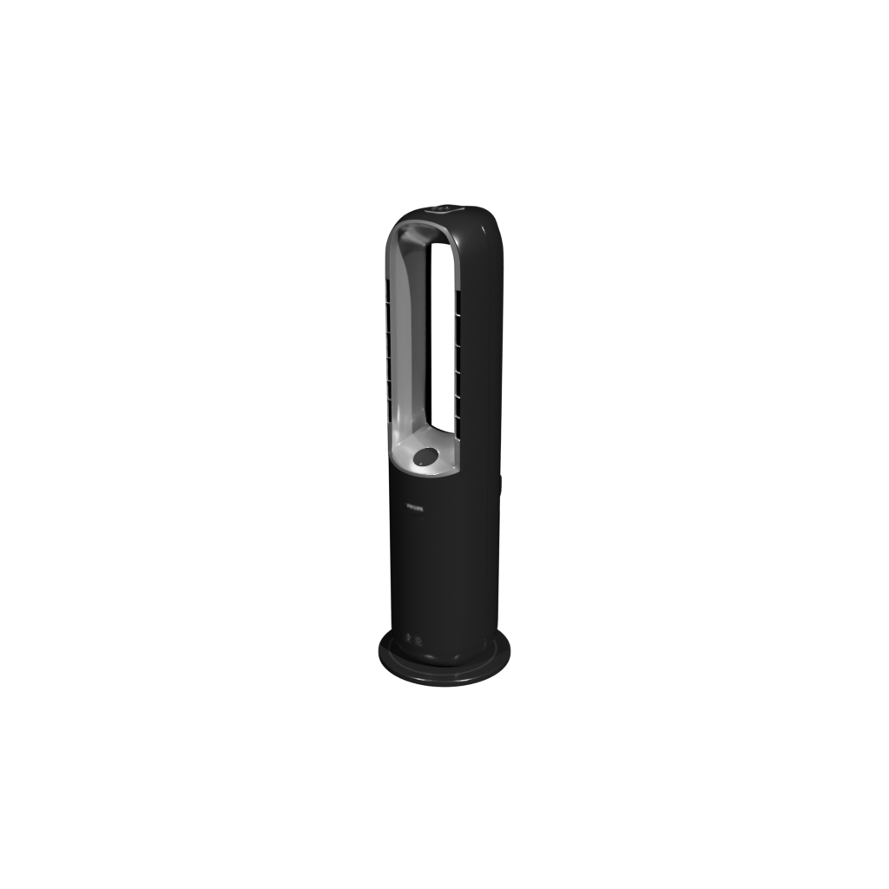

# Philips Air Performer 8000 Series 3-in-1 (AMF870/15) - Modèle 3D

Modèle 3D officiel extrait des assets 3D Amazon AR (`B0BL898WJZ`).

## Caractéristiques techniques

- **Produit** : Philips Air Performer Série 8000 (Purificateur, Ventilateur & Chauffage 3-en-1)
- **Référence modèle** : AMF870/15
- **Couleur** : Noir / Gris foncé métallique
- **ASIN Amazon** : `B0BL898WJZ`
- **URL archive source** : `https://m.media-amazon.com/images/I/917Runt7HNL.zip`
- **Dimensions réelles (mètres)** :
  - Largeur (X) : 0.314 m (31.4 cm)
  - Profondeur (Y) : 0.314 m (31.4 cm)
  - Hauteur (Z) : 1.058 m (105.8 cm)
- **Géométrie** :
  - Sommets : 72 512
  - Indices / Triangles : 391 716 indices (~130 572 triangles)
  - Compression géométrie : Draco (`KHR_draco_mesh_compression`)
- **Matériaux & Textures PBR** :
  - `baseColorTexture2.jpg` (2048x2048)
  - `metallicRoughnessTexture3.jpg` (2048x2048)
  - `normalTexture0.png` (2048x2048, transcodée depuis Basis avec reconstruction des normales RGB)
  - `transmissionTexture1.jpg` (512x512, `KHR_materials_transmission`)
- **Poids GLB assemblé** : ~873 Ko (optimisé Draco)

## Rendu preview

